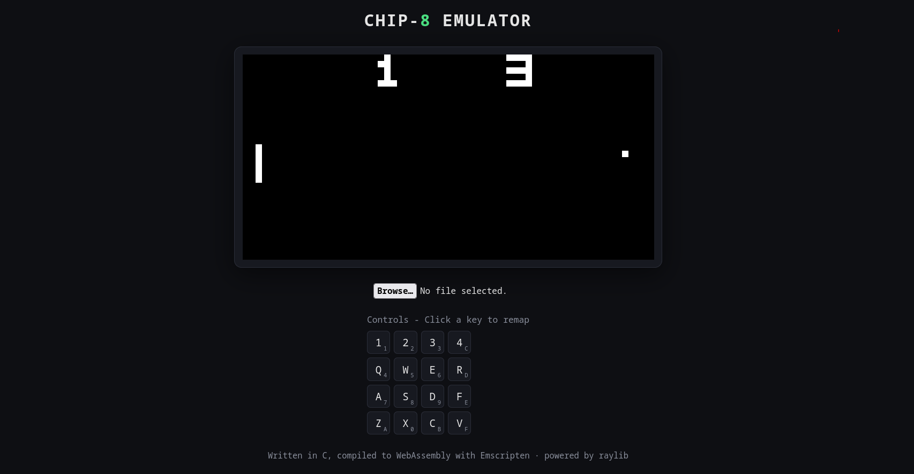

# CHIP-8 Emulator

This project is a CHIP-8 emulator, living in your browser with WebAssembly

**▶ [Try it in your browser](https://kingofpottatoes.github.io/CHIP-8/)**

(for Pong the keys are the two top-left keys)



Made with the help of [this tutorial](https://tobiasvl.github.io/blog/write-a-chip-8-emulator/)
(big thx to him)

## Features

- All 35 original CHIP-8 instructions
- Original CHIP-8 quirks (vF reset, memory, shifting, clipping)
- Sound
- Keys remap (because thats better)
- Loading your own Rom (to try your own Roms)
- Web Export with WebAssembly

## Controls

Key are mapped by physical position using Raylib

On the web version you can remap them like you want

## Building

### Desktop

Requirements: `gcc`, `make`, [raylib](https://www.raylib.com/)

then:

```bash
make
./chip8 path/to/rom.ch8
```

### Web

Requirements: [Emscripten](https://emscripten.org/), raylib compiled for the web

```bash
make web
cd docs && python -m http.server
```

finally open the website on http://localhost:8000

## What's next

My goal is to do the same, but with a Game Boy, to play Pokémon on it.

because i was to young to play the first game, im making my own emulator to try it :)